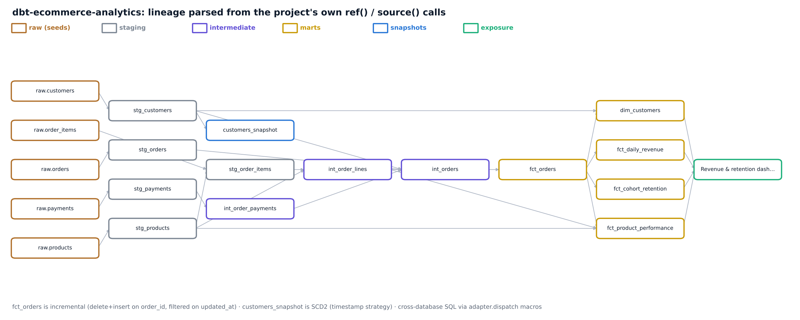
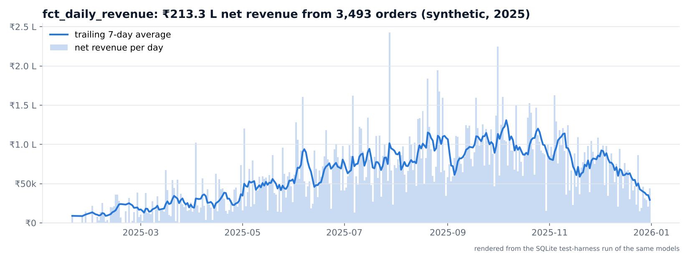
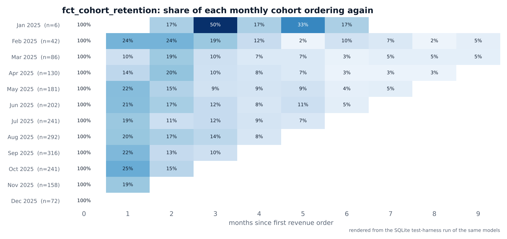
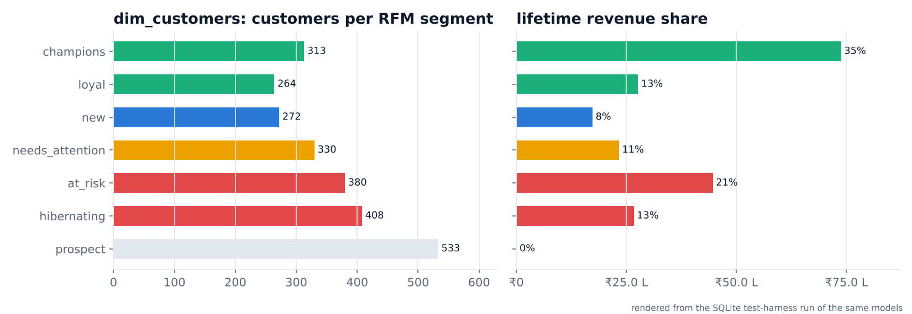
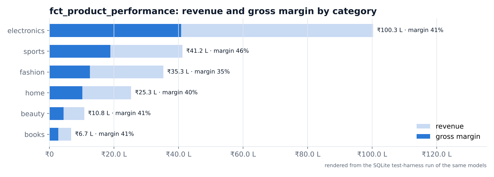
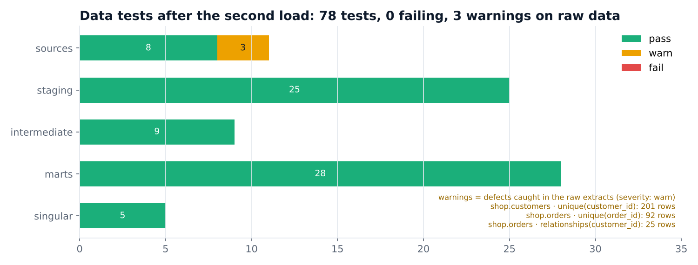

# dbt E-commerce Analytics

[](https://github.com/vishavjit-singh/dbt-ecommerce-analytics/actions/workflows/ci.yml)


An analytics-engineering project in **dbt** on **DuckDB** for a (synthetic) online shop. Five raw extracts flow through **staging → intermediate → marts**:

- an order fact, a customer dimension with RFM segments, daily revenue, monthly cohort retention and product performance
- **78 data tests**, including custom generic and singular tests
- an **incremental** fact table that also picks up late changes to old orders
- an **SCD2 snapshot** of customers
- docs blocks, an exposure and cross-database macros

The raw data is messy on purpose: duplicate deliveries, stale customer versions, test accounts, orphan orders, broken quantities, missing prices and mixed-case statuses. Every chart below was produced by running the project's models, and the revenue figures match the generator's independently computed truth to the cent.

> **How this was built.** dbt and DuckDB could not be installed in the environment this repo was written in. So the models were developed and checked with a small **SQLite test harness** (`src/ecom/harness.py`). It renders the same model files with Jinja and runs them on SQLite, with every dialect-specific expression going through `adapter.dispatch` macros. The charts in this README come from that harness run. **The first real `dbt build` happens in CI**. The `dbt` job builds both data loads on DuckDB, runs `dbt docs generate`, compares every mart with the harness output (`python -m ecom compare`) and re-renders the charts from DuckDB as a build artifact.



## Why this project

| Problem in the raw data or the warehouse | How the project handles it |
|---|---|
| The customer extract re-delivers rows and sometimes sends an older version next to the current one | `stg_customers` keeps the latest `updated_at` per customer. A `unique` source test (severity `warn`) reports how many keys were duplicated |
| Status values arrive as `Completed `, `SHIPPED`, `completed` | Normalised once in staging. An `accepted_values` test guards the clean value set |
| Internal QA accounts place orders | Flagged in staging (`is_test_account`) and excluded from every fact, so revenue is never inflated |
| Orders point at customers that don't exist | A `relationships` source test (severity `warn`) counts them. `int_orders` keeps only orders with a known customer |
| Zero/negative quantities, missing unit prices | Bad lines are dropped in `int_order_lines`. A missing price falls back to the list price and is flagged `is_price_imputed` |
| A daily rebuild of the order fact gets slow, but returns and status changes touch *old* orders | `fct_orders` is **incremental** (`delete+insert` on `order_id`), filtered on `updated_at`, the later of the order's update and its last payment, with a look-back var. A test proves the incremental table equals a full refresh |
| Analysts need "which country was this customer in last month?" | `customers_snapshot`: **SCD2** history (timestamp strategy) |
| SQL dialects differ (date truncation, date differences, string aggregation, intervals) | All dialect-specific SQL lives in dispatched macros (`xdb_month`, `xdb_days_between`, `xdb_listagg_distinct`, …). The models contain none, and a test enforces it |
| Metrics drift apart between tables | Singular tests reconcile daily revenue and customer lifetime revenue with the order fact, to the cent |

## Results from the demo run

`make demo` generates two deliveries of **synthetic** data for 2025 and runs both through the models:

- **Load 1:** orders up to 24 Dec.
- **Load 2:** a week of new orders, 30 late status changes and 40 customer country changes.

The images below are rendered from the resulting marts.

**`fct_daily_revenue`**, revenue-bearing orders (completed or shipped) only:



**`fct_cohort_retention`**: of the customers whose first revenue order fell in a month, the share who ordered again N months later:



**`dim_customers`**, RFM quintile scores as of `var('as_of_date')` and rule-based segments:





**Data tests after the second load.** The three warnings are the defects the generator injected, caught at the source:



| Metric (demo run, synthetic data, seed 42) | Value |
|---|---|
| Raw rows after load 2 | 2,714 customers · 60 products · 4,405 orders · 7,563 order items · 4,475 payments |
| Injected defects | 77 duplicate + 125 stale customer rows, 92 duplicate order rows, 42 test-account orders, 25 orphan orders, 47 bad quantities, 85 missing prices, 30 late status changes |
| Models + snapshot | 13 models (5 staging, 3 intermediate, 5 marts) + 1 snapshot |
| Data tests | 78: 0 failing, 3 warnings on raw data (201 duplicated customer ids, 92 duplicate order ids, 25 orphan orders) |
| `fct_orders` | 4,199 rows after load 1 → 4,246 after load 2. The incremental run processed 115 rows (new orders + late changes + look-back) and equals a full refresh |
| Revenue | ₹2,13,31,418.77 net from 3,493 revenue orders, identical to the generator's truth |
| Customers | 2,500 real customers (12 test accounts excluded), 1,967 with revenue orders, 914 repeat buyers |
| Snapshot, load 2 | 40 versions closed, 40 opened: one per customer change delivered |
| Month-1 retention | 20.3% (all cohorts, weighted) |

> The data is synthetic (`src/ecom/generate.py`, fixed seed): names come from short word lists and emails use `example.com`. Every number above is printed by `python -m ecom summary`.

## Project layout (dbt)

| Layer | Models | Materialization |
|---|---|---|
| sources | `raw_customers`, `raw_products`, `raw_orders`, `raw_order_items`, `raw_payments` (seeds, loaded as text) with freshness | seed |
| staging | `stg_customers`, `stg_products`, `stg_orders`, `stg_order_items`, `stg_payments`: types, dedupe, normalisation | view |
| intermediate | `int_order_lines`, `int_order_payments`, `int_orders`: valid lines, payments per order, order totals + customer order number | view |
| marts | `fct_orders` (incremental), `dim_customers`, `fct_daily_revenue`, `fct_cohort_retention`, `fct_product_performance` | table |
| snapshots | `customers_snapshot` (SCD2, timestamp strategy) | snapshot |
| exposures | `revenue_and_retention_dashboard` → the four reporting marts | |

Also included:

- **Macros:** cross-database `xdb_*` (dispatch with `duckdb__` and `sqlite__` implementations), `safe_divide`, `revenue_status_list` and `generate_schema_name`, so the schemas are called `raw`, `staging`, `marts`, …
- **Custom generic tests:** `non_negative` and `unique_combination`.
- **Singular tests:** revenue reconciliation (daily and customer), no orders after the as-of date, month-0 retention = 100%, and completed orders fully paid.
- **Docs:** `docs.md` blocks for statuses, segments and model behaviour. `dbt docs generate` runs in CI.

## Quickstart

```bash
git clone https://github.com/vishavjit-singh/dbt-ecommerce-analytics.git
cd dbt-ecommerce-analytics
python -m venv .venv && source .venv/bin/activate

# The real thing: dbt + DuckDB (no server, no credentials)
make install-dbt
make dbt-demo        # load 1 → seed + build, load 2 → seed + build (incremental + snapshot),
                     # freshness, docs, harness parity check, charts in dbt-report/
dbt docs serve       # browse lineage and column docs

# Without dbt: the SQLite test harness
make install
make demo            # harness run of both loads → docs/images → summary
make test            # 28 tests
```

### dbt commands, step by step

```bash
export DBT_PROFILES_DIR=.            # profiles.yml in the repo points at target/ecommerce.duckdb
python -m ecom generate --batch 1    # writes seeds/raw_*.csv
dbt seed && dbt build                # seeds, models, snapshot, 78 tests
python -m ecom generate --batch 2
dbt seed && dbt build                # fct_orders runs incrementally; the snapshot closes changed rows
dbt build --full-refresh -s fct_orders
dbt source freshness
dbt docs generate
```

### Python tools

```bash
python -m ecom generate --batch 1|2              # synthetic raw extracts as dbt seeds
python -m ecom harness                           # both loads through the SQLite harness
python -m ecom report [--db target/ecommerce.duckdb] [--out dir]
python -m ecom summary                           # the numbers quoted above
python -m ecom compare                           # dbt-duckdb marts vs harness marts (CI)
```

## Project structure

```
├── dbt_project.yml · profiles.yml          # DuckDB file in target/, no credentials
├── models/
│   ├── staging/        _sources.yml (+ freshness, source tests) · stg_* · _staging.yml
│   ├── intermediate/   int_* · _intermediate.yml
│   ├── marts/          fct_* · dim_customers · _marts.yml
│   ├── docs.md         docs blocks
│   └── exposures.yml
├── macros/             cross_db.sql (dispatch) · helpers.sql · generate_schema_name.sql
├── snapshots/          customers_snapshot.sql
├── tests/              singular tests · generic/ (non_negative, unique_combination)
├── analyses/           revenue_by_channel.sql
├── seeds/              generated raw_*.csv (git-ignored)
├── src/ecom/           generate.py · harness.py (SQLite test harness) · demo.py · report.py · compare.py
├── pytests/            28 pytest tests (generator, harness, project lint, model logic vs truth)
├── Dockerfile · Makefile
└── .github/workflows/ci.yml                # harness + tests, real dbt build on DuckDB, docker
```

## Testing

There are two kinds of tests:

- **dbt data tests** (78): run by `dbt build` in CI and by the harness locally.
- **pytest** (28):
  - *Model logic against the generator's truth.* Daily revenue for every day and lifetime revenue for every customer match to the cent. Staging keeps the latest customer version. Test accounts and orphans never reach the facts. Late status changes reach the incremental fact. Incremental equals full refresh. The snapshot closes exactly one version per customer change. Cohorts start at 100%. RFM scores are true quintiles.
  - *Project lint.* Every model is documented and tested. Doc blocks exist. Every dispatched macro has both a `duckdb__` and a `sqlite__` implementation. Seed column types match the generator. Exposure refs resolve. Rendered DuckDB SQL contains no SQLite functions, and the reverse.
  - *The harness itself.* Dispatch, vars, the incremental branch, dependency order, unknown refs, and the mart comparison.

## Limitations and roadmap

- **dbt was not run before this repo was published.** The CI `dbt` job is the first real `dbt build`. The harness supports only the dbt features this project uses (view/table/incremental `delete+insert`, timestamp snapshots, the four built-in generic tests plus custom ones). It is a test tool, not a dbt replacement.
- The harness's snapshot only approximates dbt's: it has no `dbt_scd_id` and does not handle hard deletes.
- The data is synthetic and small (about 4.4k orders), and the FX-free INR amounts are illustrative.
- Next: model contracts and versions on the marts, `dbt-expectations`-style distribution tests, a semantic layer (MetricFlow) for revenue metrics, and a scheduled run with Airflow or Dagster.

## Author

**Vishavjit Singh Saini**, Data Engineer
[Portfolio](https://vishavjit-singh.pages.dev/) · [LinkedIn](https://www.linkedin.com/in/vishavjit-singh-7011211ab/) · [GitHub](https://github.com/vishavjit-singh)

## License

[MIT](LICENSE)
